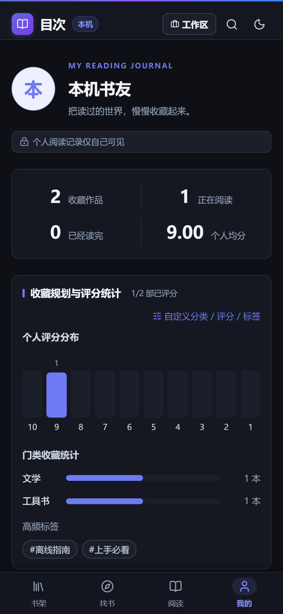
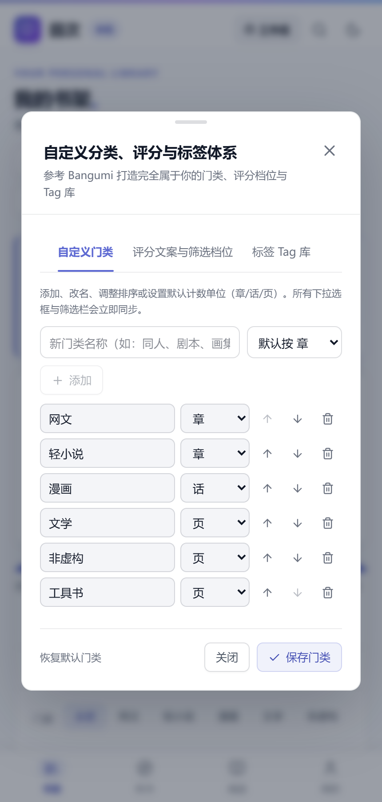
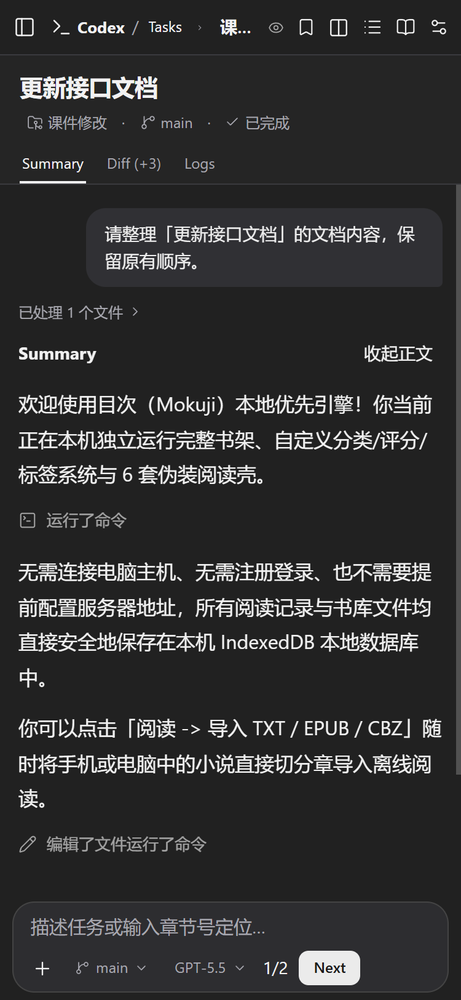
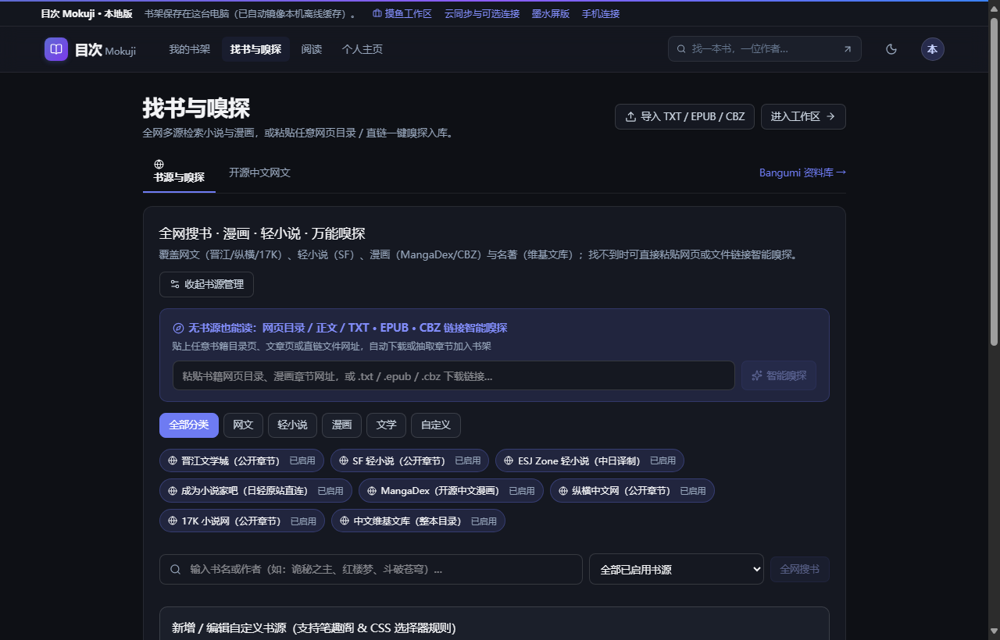
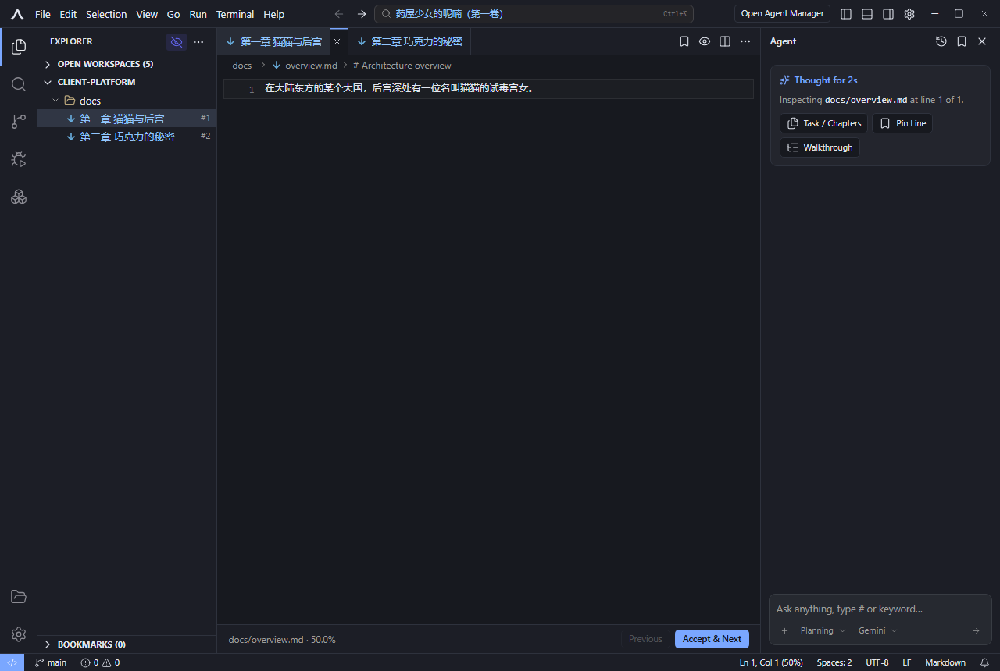
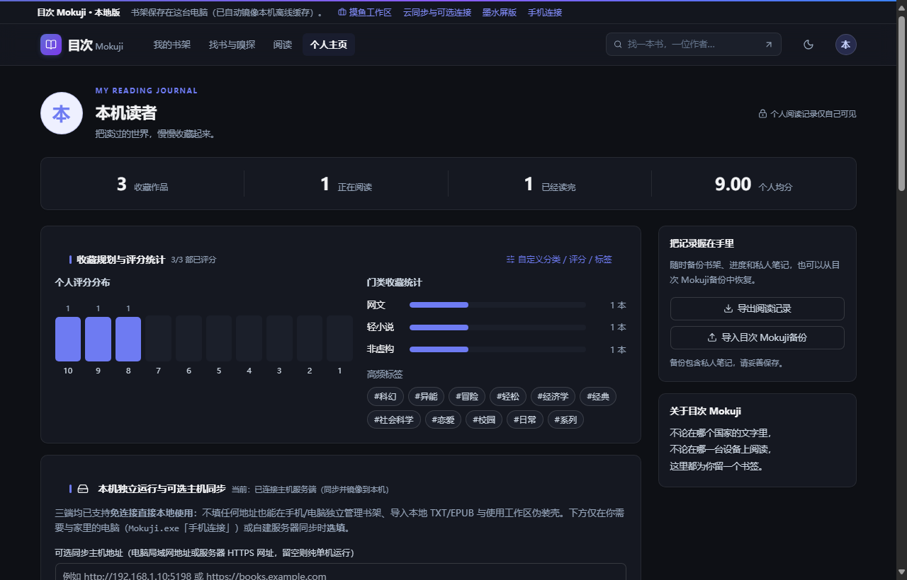
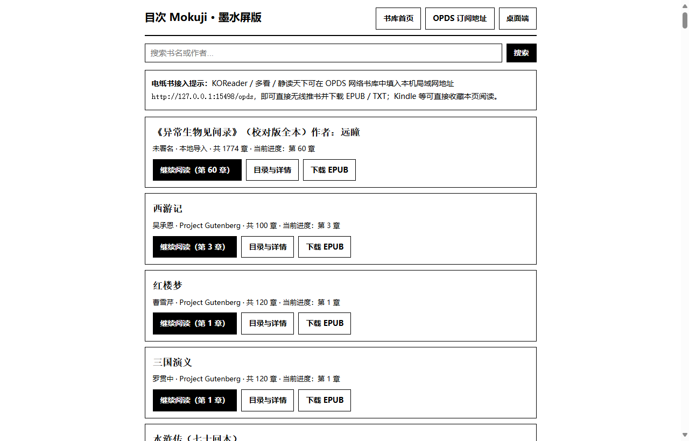
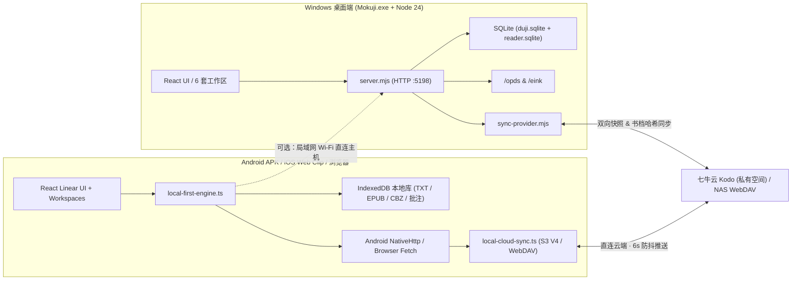

<div align="center">

# 目次 · Mokuji v2.0

**本地优先（Local-First）的三端阅读器 · Bangumi 级自定义书架 · 万能网页嗅探 · 六套拟真办公摸鱼工作台**

[](https://github.com/Rinyanami/mokuji/releases/latest)
[](#许可说明)
[](#多端覆盖矩阵)
[](#架构与同步原理)

支持 **Windows（WebView2 桌面单入口）**、**Android（原生离线 WebView APK）**、**iOS（免签名全屏 Web Clip + 快捷指令）**、**浏览器 PWA** 以及 **电纸书（OPDS 1.2 + E-Ink 极简网页）**。

</div>

---

## 直接下载各端安装包（[Releases v2.0.0](https://github.com/Rinyanami/mokuji/releases/latest)）

| 平台 | 安装包直链 | 说明 |
| :--- | :--- | :--- |
| **Windows (64位安装向导)** | [Mokuji-Setup-Win64-v2.0.0.exe](https://github.com/Rinyanami/mokuji/releases/download/v2.0.0/Mokuji-Setup-Win64-v2.0.0.exe) | 内置 Node.js 24 运行时与 WebView2 单入口，支持 `Ctrl+Alt+M` 全局老板键与托盘驻留 |
| **Windows 分享压缩包** | [Mokuji-Windows-v2.0.0.zip](https://github.com/Rinyanami/mokuji/releases/download/v2.0.0/Mokuji-Windows-v2.0.0.zip) | 内含 `Mokuji-Setup-Win64-v2.0.0.exe` 与 `使用说明.txt` |
| **Android 离线客户端** | [Mokuji-Android-v2.0.0.apk](https://github.com/Rinyanami/mokuji/releases/download/v2.0.0/Mokuji-Android-v2.0.0.apk) | 原生离线壳（全面屏安全区适配、`.txt`/`.epub`/`.cbz` 离线解析、全书搜索与七牛/WebDAV 同步） |
| **iPhone / iOS** | [Mokuji-iPhone-Unsigned-v2.0.0.ipa](https://github.com/Rinyanami/mokuji/releases/download/v2.0.0/Mokuji-iPhone-Unsigned-v2.0.0.ipa) | 未签名 IPA（适用 TrollStore / 自签）；日常使用建议在电脑端开启「手机连接」后用 Safari 安装永久不掉签的 Web Clip |
| **校验码** | [SHA256SUMS.txt](https://github.com/Rinyanami/mokuji/releases/download/v2.0.0/SHA256SUMS.txt) | 各端二进制包 SHA-256 哈希清单 |

---

## 界面预览（桌面端 · 移动端 · 摸鱼工作区 · 墨水屏）

### 移动端 Linear 风格 4-Tab 交互 & 原生离线阅读
| 我的书架（置顶续读 · 一键导入） | 找书与万能网页嗅探 | 评分分布与云同步（暗色） | Bangumi 自定义面板 & 移动端工作区 |
| :---: | :---: | :---: | :---: |
|  |  |  |  |

<p align="center">
  
</p>

### 桌面端书架、多书源嗅探、拟真工作台 & 电纸书
| 自定义书单 & Bangumi 评分书架 | 多书源搜索 & Legado 规则导入（暗色） |
| :---: | :---: |
|  |  |

| 拟真 Antigravity 工作台（0ms 悬停/全显真名） | 阅读雷达 & 多端同步 / 墨水屏入口 |
| :---: | :---: |
|  |  |

<p align="center">
  
</p>

---

## 核心特性

### 1. 三端真正独立的本地优先（Local-First）引擎
- **无需先连电脑或搭服务器，打开即用**：移动端与桌面端共享完整功能栈，内置浏览器/Android IndexedDB 引擎（[local-first-engine.ts](MokujiMobileBuild/server/client-source/lib/local-first-engine.ts)），无后端时直接在本地持久化书架、目录、阅读进度、书签与段落批注。
- **全格式本地导入与全书正文搜索**：
  - `.txt`（智能章节识别、UTF-8 / GB18030 自动解码）
  - `.epub`（自动解包目录与内嵌插图图文混排）
  - `.cbz` / `.zip`（多话图片漫画包自动分话渲染）
  - 内置 **「搜全书正文」** 跨章关键词检索与 **「书签/批注」** 段落笔记持久化。

### 2. 六套拟真摸鱼工作区（按需拆包 · 零延迟防窥）
通过 `React.lazy` 按需加载拆包，可在阅读页面无缝切换 **Codex**、**Claude**、**WorkBuddy**、**豆包**、**Antigravity**、**VS Code** 六套拟真办公壳，支持网页版/桌面版形态与浅色/深色主题：
- **`Ctrl + Alt + M`**（Windows 客户端）：全局老板键，任何窗口焦点下瞬间隐藏或呼出目次窗口；点关闭按钮最小化至系统托盘。
- **`Ctrl + Shift + W`**：同窗口一键在「我的书架」与「摸鱼工作区」之间切换。
- **`Space`（空格）**：工作区内瞬间切为伪装工作摘要与项目附件，再按一次回到阅读段落。
- **`Alt + V` / 眼睛图标 / 悬停**：平时以工作文件名与任务别名伪装目录，鼠标悬停 0ms 瞬显真实章节名，触屏/移动端支持一键切换全显真名。
- **抽屉与面包屑全联动**：顶部面包屑路径、项目树、Diff / Logs / Artifacts / Terminal 面板与书签索引全面打通可点击跳转。

### 3. Bangumi 级书架整理 & 双向进度联动
- 自由增删改名门类、切换 **Bangumi 标准 / 网文仙草** 等 10 分制评分语义文案、Tag 筛选与专题书单。
- 绑定 Bangumi Access Token 后，可按条目 ID 双向拉取/推送收藏状态、个人评分、阅读进度与私密标记。

### 4. 多书源检索 & 万能网页智能嗅探
- 内置 **晋江、SF 轻小说、ESJ Zone、成为小说家吧（Syosetu）、MangaDex（含原站漫画图源代理）、纵横、17K、维基文库**，并支持导入自定义规则或 Legado 兼容书源 JSON。
- 贴入任意网页目录页、长文章页、漫画页或 `.txt` / `.epub` / `.cbz` 文件直链即可智能嗅探抓取、预览并加入书架离线缓存。

### 5. 多端云同步与电纸书生态
- **七牛云 Kodo (S3 V4) / NAS WebDAV**：三端共用同一份云端快照协议，支持 6 秒防抖自动推送与随时双向拉取合并。
- **局域网免安装配对 & iOS Web Clip**：电脑端开启「手机连接」后，iPhone Safari 扫码即可安装永久不掉签全屏桌面应用（`.mobileconfig`）及一键抓书快捷指令（`/?sniff=网址`）。
- **电纸书直连**：开放 `/opds`（OPDS 1.2 自动实时封包 EPUB 下载）与极简高对比度 `/eink` 墨水屏阅读页。

---

## 架构与同步原理



---

## 多端覆盖矩阵

| 平台 | 运行形态 | 离线本地存储 | 书源嗅探与漫画 | 摸鱼工作区 | 云同步与电纸书 |
| :--- | :--- | :--- | :--- | :--- | :--- |
| **Windows** | WebView2 桌面客户端（全局老板键/托盘） | ✅ SQLite | ✅ 原生 Node 无跨域限制 | ✅ 六套桌面/网页壳 | ✅ 七牛云 / WebDAV / `/opds` / `/eink` |
| **Android** | 原生离线 APK（内置资源 & HTTP 桥接） | ✅ IndexedDB + 原生导出 | ✅ 原生 `HttpURLConnection` 代理 | ✅ 移动端抽屉与响应式排版 | ✅ 直连七牛云 / WebDAV 或局域网主机 |
| **iOS** | Safari 免签名 Web Clip（`.mobileconfig`） | ✅ IndexedDB + PWA | ✅ 通过可选同步主机或公网部署 | ✅ 全面适配刘海屏安全区 | ✅ 支持快捷指令一键嗅探 |
| **E-Ink / Kindle** | KOReader / 文石 / 内置浏览器 | ✅ EPUB 自动实时封包 | — | — | ✅ `/opds` 与 `/eink` |

---

## 目录结构

| 路径 | 说明 |
| :--- | :--- |
| `MokujiMobileBuild/server/client-source/` | React + TypeScript + Vite 前端、Linear 主题、`local-first-engine.ts` 与工作区外壳 |
| `MokujiMobileBuild/server/desktop/` | Windows WebView2 桌面宿主（`MokujiDesktop.cs`）与安装向导（`MokujiSetup.cs`） |
| `MokujiMobileBuild/server/*.mjs` | Node.js 服务、SQLite 存储、多书源、网页嗅探、七牛/WebDAV 同步、OPDS 1.2、Bangumi 联动 |
| `MokujiMobileBuild/server/server-deploy/` | Docker + Caddy 自建公网 HTTPS 服务部署模板 |
| `MokujiMobileBuild/android/` | Android Java 原生壳（离线资产拦截、`WindowInsets` 适配、跨源 HTTP 桥接、APK 构建脚本） |
| `MokujiMobileBuild/ios/`、`ios-binary/` | iOS Xcode 工程与未签名 IPA 构建脚本 |
| `Cotex/` | 桌面阅读联动配套模块、测试固件与 MIT 许可 |

---

## 快速运行与自行构建

### 1. 运行本地服务（Node.js 24+）
```powershell
cd MokujiMobileBuild/server
node launcher.mjs
# 或在 Windows 中直接双击 MokujiMobileBuild/server/Start-Mokuji.cmd
```

### 2. 构建前端与纯净网页包
```powershell
cd MokujiMobileBuild/server/client-source
npm ci
npx tsc --noEmit
node build.mjs
```

### 3. 构建并签名 Android APK（JDK 17 + Android SDK 35）
```powershell
$env:MOKUJI_SIGN_PASS = "<your-keystore-password>"
powershell -ExecutionPolicy Bypass -File MokujiMobileBuild/android/build.ps1 `
  -Jdk "D:\APP\jdk-17" `
  -BuildTools "D:\APP\android-sdk\build-tools\35.0.0" `
  -PlatformJar "D:\APP\android-sdk\platforms\android-35\android.jar" `
  -Keystore "<path-to-your-release.p12>" `
  -Output "MokujiMobileBuild/server/web/install/Mokuji-Android.apk"
```

### 4. 自建服务器部署（VPS / Docker / Vercel）
- **VPS / NAS 自托管**：参考 [MokujiMobileBuild/server/server-deploy/README.md](MokujiMobileBuild/server/server-deploy/README.md)，通过 `compose.yaml` + `Caddyfile` 即可部署完整多端后端与公网 HTTPS 同步。
- **静态 Pure Local-First Web 部署**：仓库根目录已附带 [vercel.json](vercel.json)，可直接将 `MokujiMobileBuild/server/web` 作为纯静态本地优先版托管至 Vercel / Netlify。

---

## 许可说明

本项目源码已完全移除所有个人书库数据、SQLite 数据库、签名证书与云存储密钥，个人账号及七牛云 AK/SK 请在启动应用后于「个人主页 → 云同步设置」或环境变量中自行填写。核心工程遵循 [MIT License](Cotex/LICENSE)。
